# Torus RV32 SoC

A 2D torus of RV32IM tiles (CV32E40X) with scratchpads, DMA and a credit-based
two-plane NoC, simulated in Verilator and synthesized in Yosys. The design,
milestones and verification plan are in [SPEC.md](SPEC.md).

Status: M0 (one tile, Spike lockstep, area report, regression).

## Topology

<p align="center">
  
</p>

The NoC is a 2D torus of NX x NY compute tiles plus an I/O row at `y = NY`,
which holds the I/O tile at `(0, NY)` and router-only stops. Laid out in logical
order, every wraparound link would span the whole die. Each ring is instead
folded once and its two layers interleaved. The I/O row is first rotated to the
top die edge, where the pads are, and stays there while the compute rows fold
onto each other exactly like the columns. At 8x8 that gives the physical column
order `0 7 1 6 2 5 3 4` and row order `8 0 7 1 6 2 5 3 4`, so every link,
wraparound included, spans at most two tile pitches. The fold is a placement
decision only: the RTL is the same, and the floorplan (ASIC) or pblocks (FPGA)
apply it. With the optional buffer columns (`x = NX/2` and `x = NX + 1`) both
land on the left and right edges:
[docs/img/torus_fold_buffers.svg](docs/img/torus_fold_buffers.svg).

Regenerate the animations after a topology change (the script checks the
two-pitch link bound):

```sh
python3 scripts/gen_fold_svg.py --nx 8 --ny 8 -o docs/img/torus_fold.svg
python3 scripts/gen_fold_svg.py --nx 8 --ny 8 --buffer-cols -o docs/img/torus_fold_buffers.svg
python3 scripts/gen_fold_svg.py --nx 8 --ny 8 --frame 14.5 -o final.svg   # one static frame
```

## Quick start

Everything runs in the pinned tool image (tools/versions.env); Docker is the
only host requirement.

```sh
git clone --recursive <repo> && cd torus-rv32-SoC
tools/dev.sh scripts/regress.py          # build everything, run the regression
```

`tools/dev.sh <cmd>` runs a command in the image with the repository at /work.
It pulls `ghcr.io/<owner>/torus-tools:$(tools/image_tag.sh)`; CI builds and
pushes that image whenever versions.env, the Dockerfile or the installer
change. Without the registry image it falls back to a local build:

```sh
source tools/versions.env
docker build -f docker/Dockerfile --build-arg BASE_IMAGE="$BASE_IMAGE" -t torus-tools:local .
```

On a Linux host without Docker, Podman or Apptainer run the same image
(`apptainer exec docker://ghcr.io/<owner>/torus-tools:<tag> ...`). There is no
native install path: one image keeps every run on identical tools.

The first build compiles Spike from `third_party/spike` (about 5 minutes); later
builds reuse it while the submodule commit is unchanged.

## Common tasks

```sh
tools/dev.sh cmake -S . -B build -G Ninja -DCMAKE_BUILD_TYPE=Release
tools/dev.sh ninja -C build

# Run a program on one tile, Spike in lockstep
tools/dev.sh build/tb/soc/tb_tile build/sw/hello.elf
tools/dev.sh build/tb/soc/tb_tile build/sw/regtest.elf --coord=3,5 --trace=build/regtest.fst
tools/dev.sh build/tb/soc/tb_tile build/sw/isa/rv32ui-add.elf --rvfi-trace

# Regression: replay a run or one test from the printed seeds
tools/dev.sh scripts/regress.py --seed 1234
tools/dev.sh scripts/regress.py -k isa --no-build
tools/dev.sh build/tb/unit/tb_spm --seed=42

# Area report (Yosys generic cells, SRAM as macros)
tools/dev.sh scripts/regress.py -k synth --synth --no-build
```

Waveforms are FST files; open them on the host with Surfer or GTKWave.

## Layout

| Path | Contents |
| --- | --- |
| `rtl/` | SystemVerilog: `pkg`, `core` (CV32E40X submodule + wrapper), `tile`, `perf`, file lists (`*.f`) |
| `tb/` | Verilator testbenches: `unit` (block tests), `soc` (tile), `models` (C++ golden models, Spike lockstep), `common` |
| `sw/` | `sdk` (crt0, linker script, tile.h), `kernels`, `isa` (riscv-tests environment) |
| `scripts/` | `regress.py`, `synth_area.py`, `gen_fold_svg.py` (topology animation) |
| `tools/`, `docker/` | Pinned versions, image, native setup, `dev.sh` |
| `third_party/` | Spike and riscv-tests submodules |

## Notes for kernel writers

- Build for `rv32im_zicsr`; the core also implements Zca, but code never uses it.
- `mtvec` keeps only bits [31:7] on CV32E40X: trap entries must be 128-byte aligned (crt0 does this).
- Data bus errors (for example an unmapped MMIO address) arrive as an NMI, `mcause = 0x80000400` (load) or `0x80000401` (store), after the faulting access retires.
